# DataKit Manager

<p align="center"></p>

**DataKit Manager** 是[观测云](https://www.guance.com) DataKit 的图形化管理工具：导入 kubeconfig 管理多个 Kubernetes 集群里的 DataKit，
导入 SSH 密钥管理 Linux 主机上的 DataKit。安装、看状态、改采集器配置都在一个界面里完成，不需要手写 YAML、`kubectl edit` 或登录到每台机器上改文件。

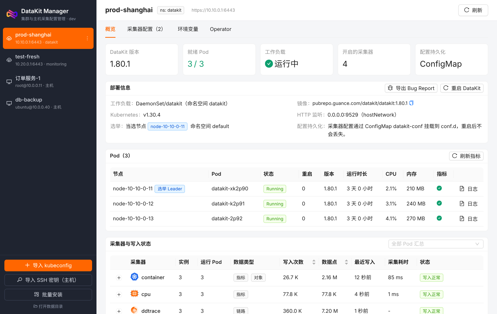

## 目录

- [产品介绍](#产品介绍)
- [界面截图](#界面截图)
- [快速开始](#快速开始)
- [使用指南](#使用指南)
- [部署方式](#部署方式)
- [配置是怎么落到集群里的](#配置是怎么落到集群里的)
- [本地数据与密钥加密](#本地数据与密钥加密)
- [所需权限](#所需权限)
- [从源码构建](#从源码构建)
- [开发](#开发)
- [已知限制](#已知限制)

## 产品介绍

### 解决什么问题

在 Kubernetes 里给 DataKit 加一个采集器，通常要：写 TOML → 放进 ConfigMap → 在工作负载里加 `volumeMounts` → 重启 → 再去看有没有数据。
集群一多、每个集群的持久化方式又不一样（有的挂了 ConfigMap，有的挂了 PVC / hostPath，有的什么都没挂），这件事既繁琐又容易出错。
主机上的 DataKit 也是同样的问题，只是换成了逐台 SSH。

DataKit Manager 把这些步骤收进一个界面：它先检查每个集群 / 主机的现状，再按现状决定配置该写到哪里，每次修改都先给出预览，确认后应用并自动重启 DataKit。

### 功能一览

| 功能 | 说明 |
|---|---|
| 多集群管理 | 一个 kubeconfig 里的每个 context 是一个集群，可分别设置 DataKit 所在命名空间（默认 `datakit`） |
| 三种部署形态 | 自动识别以 DaemonSet、StatefulSet 或 Deployment 部署的 DataKit |
| Linux 主机 | 通过 SSH 安装（在线 / 离线上传）、查看状态、修改采集器配置和主配置 `datakit.conf` |
| 概览 | 版本、Pod / 服务状态、CPU / 内存、选举 Leader、各采集器写入状态（写入次数、数据点、最近写入、错误）、DataWay 上报成功率、日志 |
| 采集器配置 | 显示**实际生效**的配置。MySQL、Redis、Kafka、PostgreSQL、Elasticsearch、MongoDB、Nginx、RabbitMQ、SQL Server、Oracle、Memcached、Prometheus Exporter、文件日志提供表单；其余约 100 个采集器基于官方示例用 TOML 编辑，表单和 TOML 可随时切换 |
| 自动处理持久化 | conf 目录已持久化就写进该目录；已有 ConfigMap 就沿用；什么都没有时自动创建 ConfigMap 并以 subPath 挂载（不依赖存储插件） |
| 环境变量 | DataKit 基础设置、默认开启的采集器，以及 DDTrace、容器、OpenTelemetry、RUM 等简单采集器 |
| 预览后应用 | 每次修改先展示将执行的操作和内容 diff，应用后自动重启 DataKit 并显示进度；变更前自动备份 |
| 一键安装 DataKit | 集群用官方 `datakit.yaml`（应用前可查看和修改），主机用官方安装程序 |
| DataKit Operator | 一键安装，并用表单（或 JSON）配置 DDTrace / OpenTelemetry 探针注入、logfwd、flameshot、Profiler、日志注解 |
| 导出 Bug Report | 一键在指定的 DataKit 实例上收集 Bug Report 并取回 zip；集群里按 Pod 导出，可按节点筛选 |
| 批量安装 | 勾选多个集群 / 主机，一次装好 DataKit 或 DataKit Operator |
| 离线环境 | 集群：改写镜像地址并给出推送到私有仓库的命令；主机：本机下载安装包后经 SSH 上传；Windows 有纯离线包 |
| 凭据加密 | 导入的 kubeconfig 和 SSH 私钥以 AES-256-GCM 加密后落盘 |

### 三种交付形态

功能相同，按使用场景选择：

| 形态 | 适用 | 产物 |
|---|---|---|
| macOS 应用 | 个人电脑本地使用 | `DataKit-Manager-<版本>-macos-universal.zip`（Intel + Apple Silicon） |
| Windows 应用 | 个人电脑本地使用；另有断网 Win10 可用的纯离线包 | `DataKit-Manager-<版本>-windows-x64.zip` / `-offline.zip` |
| Web 容器 | 部署在服务器或集群里，团队通过浏览器共用 | 镜像 tar（amd64 / arm64）、Linux 可执行文件、Kubernetes 部署 YAML |

## 界面截图

> 截图使用内置的演示数据（`npm run dev` 的模拟后端），不是真实环境。

**集群概览**：版本、Pod 状态、持久化方式、各采集器的写入状态。


**采集器配置**：列出实际生效的配置文件，标明来源（ConfigMap / 持久化目录 / 容器内生成）和状态。

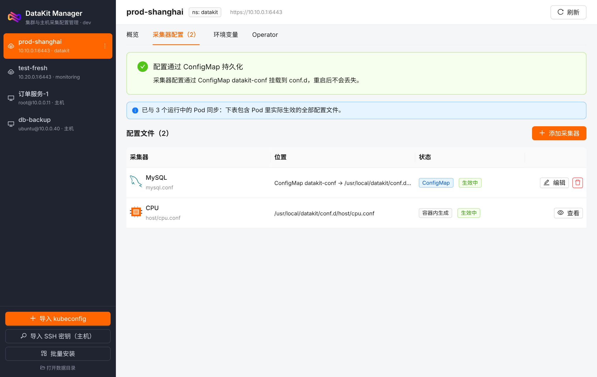

**添加采集器**：常用采集器走表单，其余基于官方示例用 TOML 编辑。

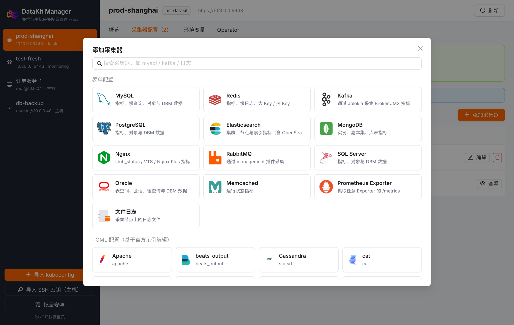

**表单编辑**：表单与 TOML 可随时切换。

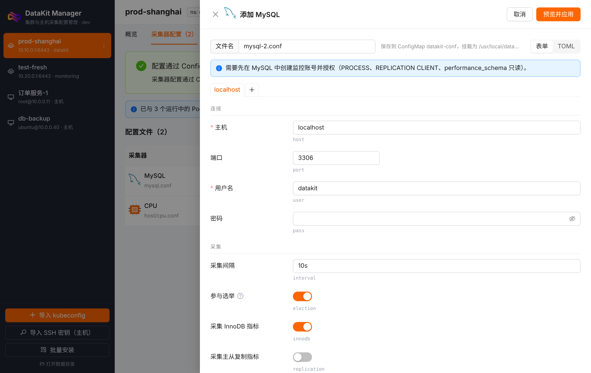

**预览并应用**：先看将执行的操作和内容 diff，再应用并重启。

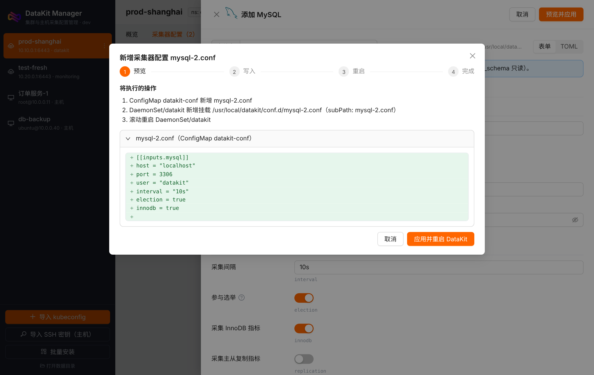

**环境变量**

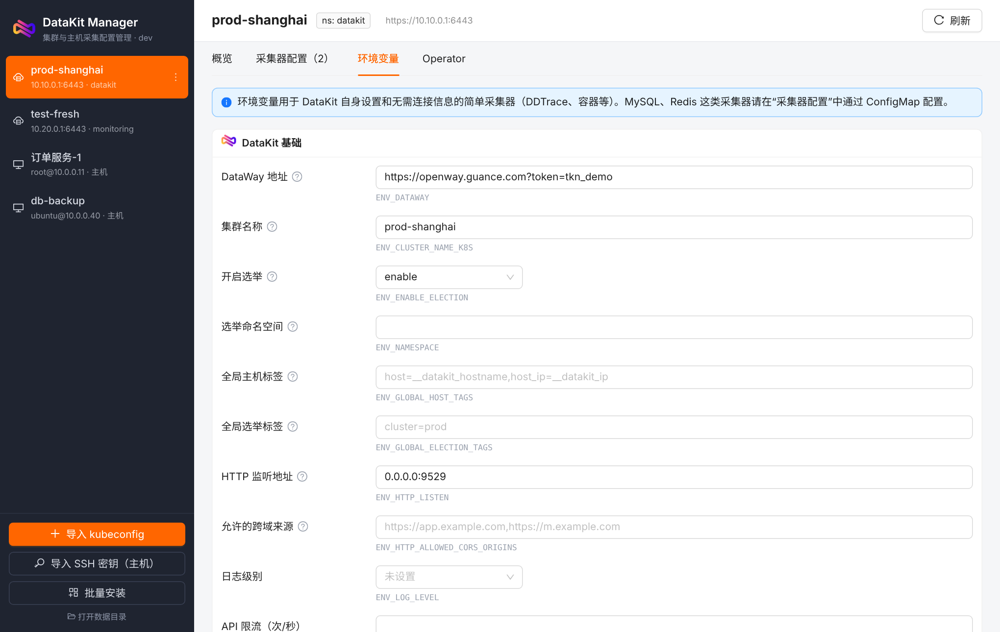

**一键安装 DataKit**：填写参数 → 确认 YAML → 安装。

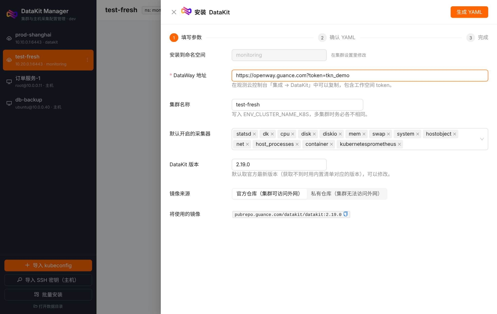

**DataKit Operator**：状态与注入规则的可视化配置。

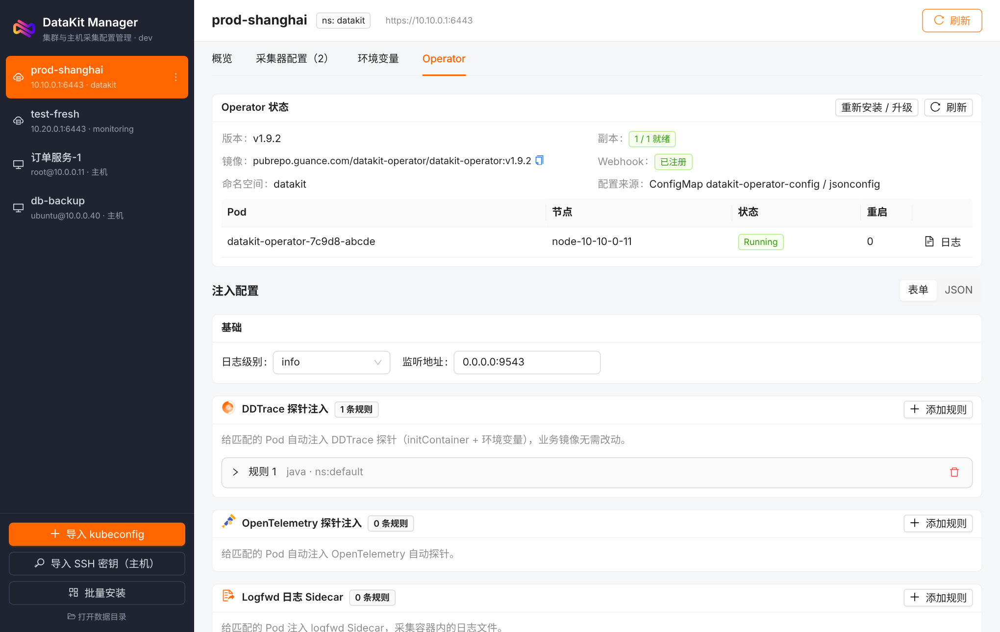

**Linux 主机**：概览、采集器配置、主配置。

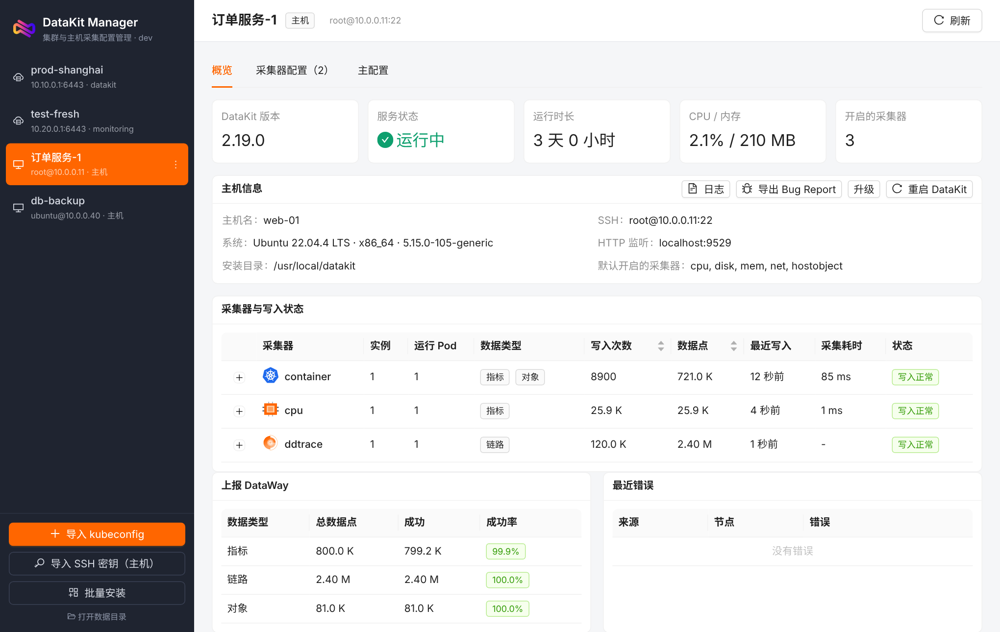

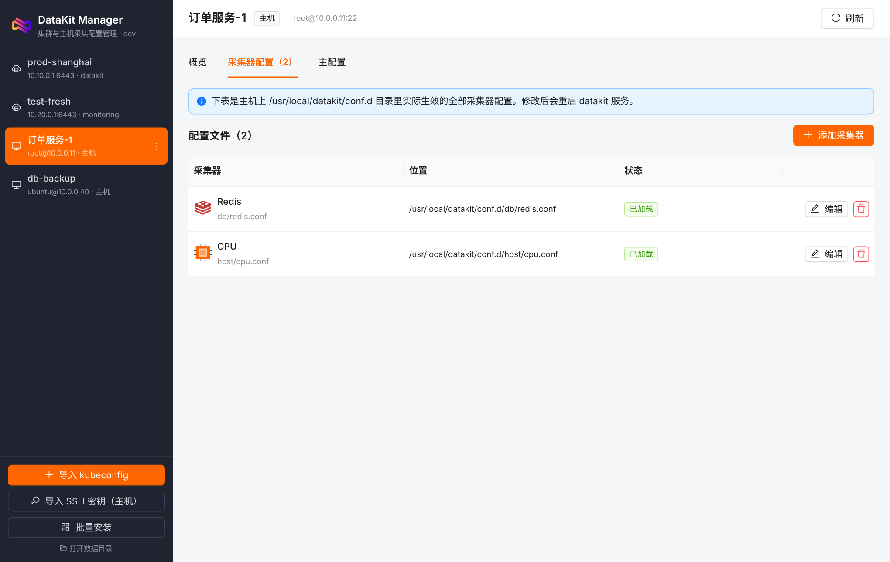

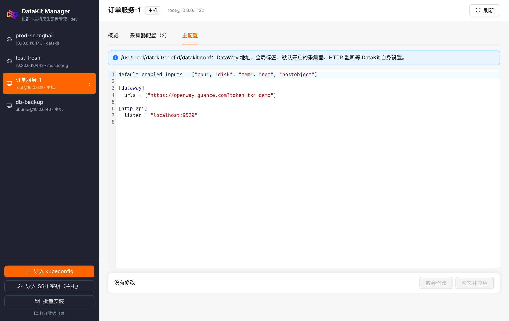

**导入 SSH 密钥**：一把密钥对应多台主机。

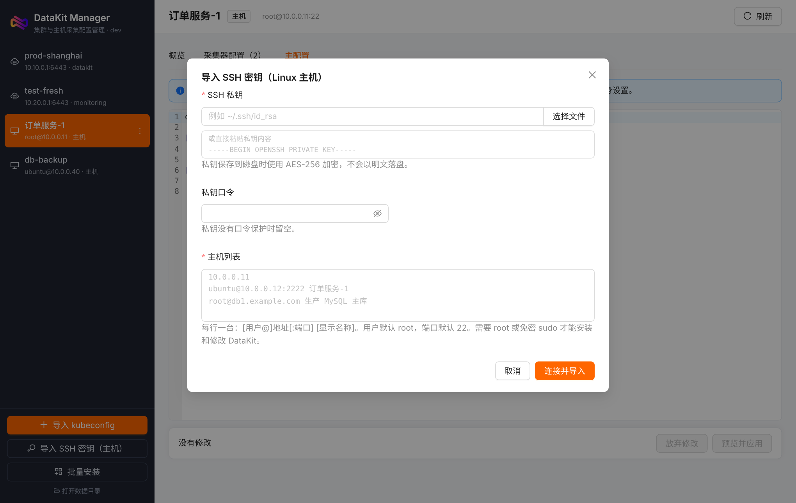

**导出 Bug Report**：选择具体的 Pod（显示所在节点，可筛选），一键导出。

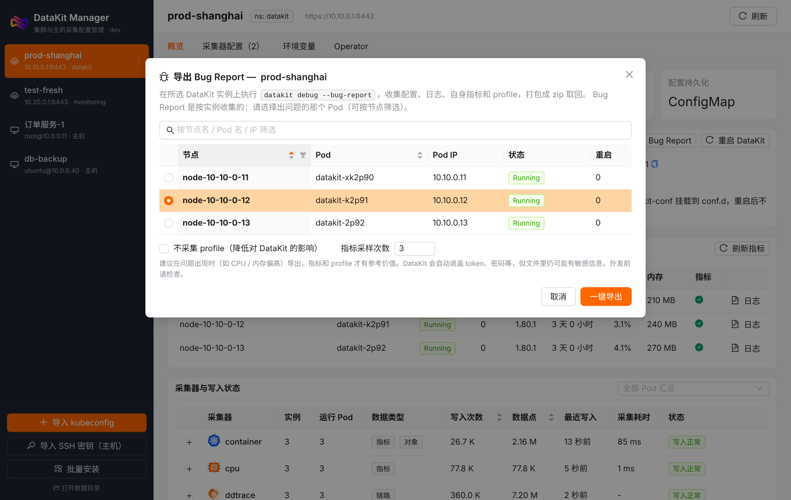

**批量安装**：勾选资产，选择产品，一键安装。

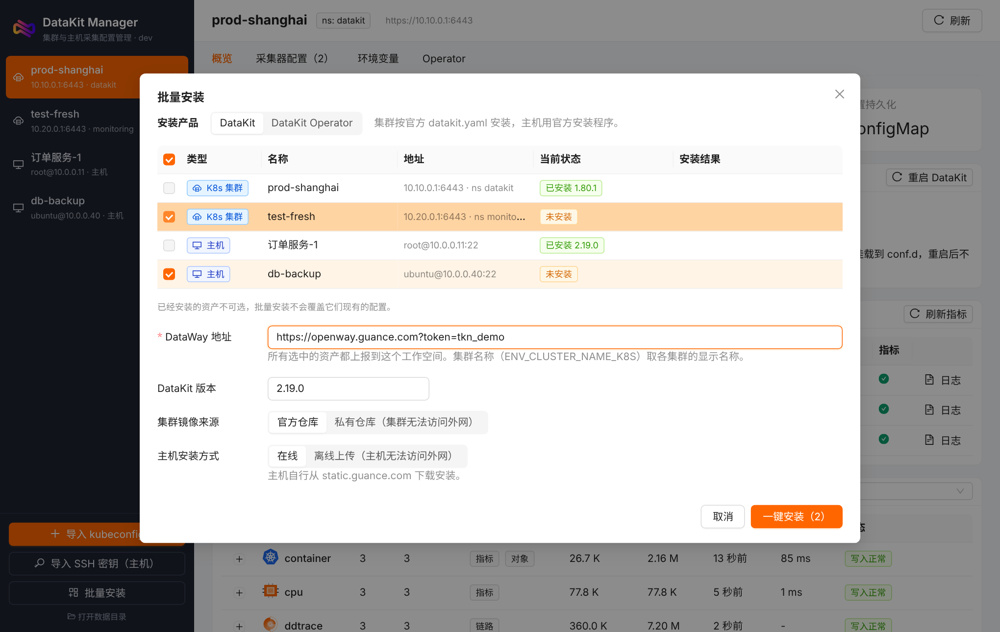

## 快速开始

1. **获取程序**：从 `dist/` 取对应平台的包（没有现成的包时见[从源码构建](#从源码构建)，一条命令 `./build.sh all`）。
2. **运行**：
   - macOS：解压后把 “DataKit Manager.app” 拖到“应用程序”，首次打开右键 → 打开。
   - Windows：解压后运行 `DataKit Manager.exe`。
   - Web：`docker run -d -p 8080:8080 -e DKM_PASSWORD='你的密码' -v dkm-data:/data datakit-manager:<版本>`，浏览器打开 `http://<主机>:8080`，用户名 `admin`。
3. **导入资产**：左下角“导入 kubeconfig”选择文件并勾选要管理的 context；或“导入 SSH 密钥（主机）”添加 Linux 主机。
4. **开始使用**：点击左侧的集群 / 主机。已有 DataKit 时直接看到概览；没有时页面会给出“一键安装 DataKit”。

## 使用指南

### 1. 导入集群

左下角“导入 kubeconfig”。一个文件里有多个 context 时可以多选，每个 context 成为一个独立的集群条目，并可分别设置 DataKit 所在的命名空间
（默认 `datakit`，之后可在集群条目右侧的菜单里修改）。导入后程序保存一份只含该 context 的加密副本，不再依赖原文件。

### 2. 概览

- 顶部卡片：DataKit 版本、就绪 Pod 数、工作负载状态、开启的采集器数、配置持久化方式。
- 部署信息：工作负载类型、镜像、选举 Leader、HTTP 监听、持久化检查结果。
- Pod 列表：状态、重启次数、CPU / 内存，可查看日志。
- 采集器与写入状态：每个采集器的实例数、数据类型、写入次数、数据点、最近写入时间、错误；可按 Pod 查看或全部汇总。
- “重启 DataKit”：滚动重启工作负载。

### 3. 采集器配置

- 列表显示 Pod 里**实际生效**的全部 `.conf`，每个文件标明来源和状态，含义见[配置是怎么落到集群里的](#配置是怎么落到集群里的)。
- “添加采集器”：选择采集器 → 填表单（或切到 TOML）→ “预览并应用”。
- 预览窗口列出将执行的每一步操作和内容 diff；点击“应用并重启 DataKit”后显示写入、重启进度。
- 编辑 / 删除已有配置同样先预览。“容器内生成”的文件只读，可以查看内容。
- 想把一份配置用到别的集群：复制 TOML，到目标集群里添加同类采集器并粘贴即可。

### 4. 环境变量

按分组列出 DataKit 的常用环境变量（DataWay、全局标签、默认开启的采集器、选举、DDTrace、容器、OpenTelemetry、RUM 等），也可以添加任意自定义变量。
来自 `fieldRef` / Secret 的变量只读。修改同样是预览后应用，应用后滚动重启。

采集器的详细配置建议放在“采集器配置”里；环境变量适合 DataKit 自身设置和 DDTrace 这类简单采集器。

### 5. 安装 DataKit 与 DataKit Operator

- **DataKit**：命名空间里找不到 DataKit 时，页面上会出现“一键安装 DataKit”。清单来自官方 `datakit.yaml`（内置版本见安装表单，可改）。安装到该集群设置的命名空间。
- **Operator**：在“Operator”页安装。**固定安装在 `datakit` 命名空间**：Operator 镜像内置的 Webhook 证书签发给 `datakit-operator.datakit.svc`，换命名空间 Webhook 无法工作。注入的探针会指向该集群 DataKit 所在的命名空间。
- **集群无法访问外网**：镜像来源选“私有仓库”，填仓库地址（如 `harbor.example.com/datakit`）。清单里的镜像会改成 `<仓库>/<镜像名>:<标签>`，页面给出 `docker pull / tag / push` 命令（可选 amd64 / arm64），以及没有仓库时 `docker save` + `ctr import` 的做法。Operator 除自身镜像外，还会用到探针、logfwd、flameshot 镜像，命令里都已列出。
- 应用方式等同 `kubectl apply`（server-side apply），重复执行是安全的；应用过的 YAML 会存一份到本地备份目录。
- Operator 配置保存在 ConfigMap `datakit-operator-config`，修改后需要重启 Operator 才生效（工具会自动重启）。新配置只影响之后创建的 Pod。

### 6. Linux 主机

左侧“导入 SSH 密钥（主机）”：选择或粘贴私钥，填主机列表（每行 `[用户@]地址[:端口] [显示名称]`，一把密钥可对应多台主机）。
导入时会逐台连接验证，并记住每台主机的主机密钥；之后主机密钥变了会拒绝连接（防止连到别的机器上）。

- **权限**：需要 root，或带免密 sudo（NOPASSWD）的用户。否则只能查看。
- **安装**：在线方式在主机上执行官方脚本 `static.guance.com/datakit-v2/install.sh`（主机需要 bash、curl 和外网）。
  离线上传方式由运行本工具的机器下载安装包（缓存在数据目录 `cache/datakit-v2/<版本>/`），通过 SSH 传到主机后用官方安装程序的
  `--offline` 模式安装；本机也没有外网时，可以把安装包手动放进这个缓存目录。
- **采集器配置**：列出 `/usr/local/datakit/conf.d` 下全部 `.conf`（即实际生效的配置），可用表单或 TOML 修改、新增、删除；
  保存后重启 datakit 服务。修改前的文件内容备份在数据目录 `backups/<主机>/`。
- **主配置**：直接编辑 `datakit.conf`（DataWay、全局标签、默认采集器等）。
- **概览**：版本、服务状态、CPU / 内存、各采集器写入状态、DataKit 日志、升级。

### 7. 批量安装

左侧底部“批量安装”：列出全部资产（集群和主机）及其当前安装状态，勾选后选择产品（DataKit / DataKit Operator）一键安装。

- 已经安装的资产不可选，不会覆盖现有配置。Operator 只适用于集群。
- DataKit：集群按官方 `datakit.yaml` 安装到各自设置的命名空间，集群名称取资产的显示名称；主机用官方安装程序。
- 集群可以选私有仓库（给出镜像推送命令），主机可以选离线上传。
- 每个资产单独显示结果，一个失败不影响其它。

### 8. 导出 Bug Report

排查 DataKit 问题、向观测云提交工单时，通常需要一份 Bug Report。概览页的“导出 Bug Report”按钮会在选定的 DataKit 实例上执行
`datakit debug --bug-report`，把生成的 zip 取回本机。

- **Bug Report 是按实例收集的**。集群里每个 Pod 是一个实例：弹窗列出全部 DataKit Pod 及其所在节点、IP、状态，
  可以按节点名 / Pod 名 / IP 搜索，也可以用“节点”列的筛选和排序，选中出问题的那个 Pod 再导出。主机只有一个实例，直接导出。
- **选项**：“不采集 profile”（DataKit 负载已经很高时使用）；“指标采样次数”（默认 3）。
- **保存**：桌面版弹出保存对话框（默认“下载”目录）；Web 版由浏览器下载。文件名形如
  `bugreport-<集群>-<节点>-<Pod>-<时间>.zip`，便于区分来自哪个实例。
- 收集通常需要 1 分钟左右。建议在问题出现时（如 CPU / 内存偏高）导出，指标和 profile 才有参考价值。
- DataKit 会自动遮盖 token、密码等，但文件里仍可能有敏感信息，外发前请检查。
- 过程中在 Pod / 主机的 `/tmp` 下建一个临时目录存放 zip，取回后即删除。取回的文件在选择保存位置之前暂存在数据目录的
  `bugreports/`（未加密），7 天后自动清理；桌面版保存成功后立即删除暂存副本。

Bug Report 里各目录的含义见官方文档 [Bug Report 分析](https://docs.guance.com/datakit/bug-report-how-to/)。

## 部署方式

### macOS

解压 `DataKit-Manager-<版本>-macos-universal.zip`，把 “DataKit Manager.app” 拖到“应用程序”。

`.app` 自包含，界面使用系统自带的 WebKit。应用只做了本地（ad-hoc）签名，拷到别的机器首次打开需要右键 → 打开。
也可以执行 `xattr -dr com.apple.quarantine "/Applications/DataKit Manager.app"` 解除拦截。

### Windows 与纯离线 Win10

界面依赖 Microsoft Edge WebView2 运行时。Windows 11 自带，Windows 10 不一定有。

| 包 | 大小 | 适用 |
|---|---|---|
| `windows-x64.zip` | ~17 MB | Win11，或已装 WebView2 的 Win10；缺少时联网安装 |
| `windows-x64-offline.zip` | ~230 MB | **断网的 Win10**。包内带微软官方的 WebView2 离线安装器 |

离线包的工作方式：启动时检查系统是否已有 WebView2；没有就静默运行包内
`WebView2\MicrosoftEdgeWebView2RuntimeInstallerX64.exe`（一次性，约 1～2 分钟，可能弹一次管理员确认），装完自动打开。
全程不联网。安装器由 `build.sh` 从微软固定链接下载并缓存在 `.toolchain/cache/`。

完全不想在目标机器上安装任何东西时，可改用“固定版本运行时”：从微软 WebView2 下载页获取 Fixed Version 的 cab 并解压，
然后 `WEBVIEW2_FIXED_DIR=<解压目录> ./build.sh windows`。运行时会放在 exe 同级的 `WebView2Runtime/`，程序优先使用它。

### Web 版：Docker

```bash
docker load -i datakit-manager-web-1.4.0-linux-amd64.tar
docker run -d --name datakit-manager -p 8080:8080 \
  -e DKM_PASSWORD='换成你的密码' \
  -e DKM_SECRET_KEY='换成一串随机字符' \
  -v dkm-data:/data datakit-manager:1.4.0
# 浏览器打开 http://<主机>:8080 ，用户名 admin
```

containerd 节点用 `ctr -n k8s.io images import <tar>` 导入镜像。

### Web 版：Kubernetes

1. 把镜像推送到集群能拉取的仓库（或在节点上 `ctr -n k8s.io images import`）。
2. 修改 `datakit-manager-web.yaml`：镜像地址，以及 Secret `datakit-manager-auth` 里的 `password` 和 `secret-key`（都必须改）。
   没有存储插件时，按文件里的注释把数据卷换成 hostPath。
3. `kubectl apply -f datakit-manager-web.yaml`（创建命名空间 `datakit-manager`、Secret、PVC、Deployment、Service）。
4. `kubectl -n datakit-manager port-forward svc/datakit-manager 8080:80` 后访问 `http://127.0.0.1:8080`；长期使用请配置带 HTTPS 的 Ingress / 网关。

### Web 版：直接运行可执行文件

不用容器时，直接运行 `datakit-manager-server-<版本>-linux-<架构>`：

```bash
DKM_PASSWORD='你的密码' DKM_DATA_DIR=/var/lib/datakit-manager ./datakit-manager-server-1.4.0-linux-amd64
```

### Web 版的环境变量

| 环境变量 | 默认 | 说明 |
|---|---|---|
| `DKM_LISTEN` | `:8080` | 监听地址 |
| `DKM_DATA_DIR` | `/data` | 集群列表、kubeconfig、备份。**需要挂卷持久化** |
| `DKM_USERNAME` | `admin` | 登录用户名（HTTP Basic 认证） |
| `DKM_PASSWORD` | 随机 | 不设置时每次启动生成随机密码并打印在日志里 |
| `DKM_TLS_CERT` / `DKM_TLS_KEY` | 无 | 提供证书后直接以 HTTPS 提供服务 |
| `DKM_SECRET_KEY` | 无 | 凭据加密密钥的来源；不设置时在数据目录生成 `secret.key` |

健康检查地址：`/healthz`（不需要认证）。

注意：

- 这个服务保存着各集群的 kubeconfig，等同于集群管理员权限。不要直接暴露到公网；跨网络访问请启用 HTTPS（上面的证书变量，或放在 HTTPS 网关后面），否则密码是明文传输的。
- 镜像以非 root 用户（uid 65532）运行。用宿主机目录做 `/data` 时先 `chown 65532:65532 <目录>`；用 docker 命名卷（如上）不需要。
- Web 版里 kubeconfig 和 SSH 私钥通过浏览器上传；管理主机时，SSH 连接从这个容器发起，容器需要能访问到主机；使用 exec 插件认证的 kubeconfig（`aws eks get-token` 等）在容器里不可用，请换成 token / 证书方式的 kubeconfig。
- 所有登录的人共用同一份集群列表，没有多用户和权限划分。

## 配置是怎么落到集群里的

“采集器配置”页显示的是**实际生效的配置**：除了 ConfigMap 里保存的，还会进到运行中的 Pod 里读取 `conf.d` 下的全部 `.conf`
（需要 `pods/exec` 权限；读不到时只显示 ConfigMap 里的，并说明原因）。每个文件标明来源和状态：

| 来源 | 说明 | 可编辑 |
|---|---|---|
| ConfigMap | ConfigMap 的 key，以 subPath 挂载 | 是 |
| 持久化目录 | conf.d（或其子目录）挂了 hostPath / PVC，文件就在该目录里 | 是 |
| 容器内生成 | DataKit 启动时生成、未持久化的文件，通常来自 `ENV_DEFAULT_ENABLED_INPUTS` | 只读 |

状态：生效中 / 待重启生效（已保存内容与 Pod 里运行的不同）/ 未挂载 / 各 Pod 不一致。

新配置保存到哪里，取决于打开集群时检查到的现状：

| 现状 | 新增 / 修改配置的保存方式 |
|---|---|
| conf.d 已挂载 hostPath / PVC 等持久化目录 | **直接写入该目录**：进到每个运行中的 Pod 里写文件，不创建 ConfigMap |
| conf.d 下已有 ConfigMap 挂载 | 沿用该 ConfigMap：写 key，新 key 追加 subPath 挂载 |
| ConfigMap 整体挂成目录（无 subPath） | 只写 key，不再加挂载 |
| 没有任何持久化（官方 yaml 的默认状态） | 创建 `datakit-conf` ConfigMap、声明卷并以 subPath 挂载 |

已有文件始终在它原来的位置上修改。之后更新 Pod 模板上的 `datakit-manager/restartedAt` 注解触发滚动重启。

写入持久化目录时的注意点：hostPath 每个节点各有一份，本次只会写入当前有 Pod 在运行的节点；之后新加入的节点需要重新应用一次
（列表里会显示“各 Pod 不一致”）。未在运行的 Pod 写不进去，预览和结果里会提示。

删除 ConfigMap 里的配置时先移除挂载、再删 key，避免新 Pod 因 subPath 不存在而起不来。每次应用前，工作负载和 ConfigMap 的 YAML
会备份到数据目录的 `backups/<集群>/`。

StatefulSet / Deployment 部署的 DataKit 处理方式相同，只是改的是对应的工作负载。StatefulSet 用 `volumeClaimTemplates` 挂载 conf.d 时会被识别为持久化目录。
工作负载的更新策略是 `OnDelete` 时，Pod 不会自动重启：预览里会给出提示，应用后需要手动删除 Pod 才生效。

环境变量直接改工作负载里 datakit 容器的 `env`；来自 `fieldRef` / Secret 的变量只读。

## 本地数据与密钥加密

| 系统 | 位置 |
|---|---|
| macOS | `~/Library/Application Support/datakit-manager/` |
| Windows | `%AppData%\datakit-manager\` |
| Web 版 | `DKM_DATA_DIR`（默认 `/data`） |

- `clusters.json` / `hosts.json`：资产列表（名称、地址、用户名，不含凭据）
- `kubeconfigs/<id>.enc`：每个集群一份独立的 kubeconfig（只含该 context，证书已内联）
- `sshkeys/<id>.enc`：每台主机的 SSH 私钥和口令
- `secret.key`：加密密钥
- `backups/<id>/`：每次变更前的备份，以及通过本工具应用过的安装 YAML
- `cache/`：为离线安装下载的 DataKit 安装包
- `bugreports/`：导出的 Bug Report 暂存（未加密，7 天后自动清理）

**导入的 kubeconfig 和 SSH 私钥以 AES-256-GCM 加密后保存**，磁盘上没有明文（Web 版上传的临时文件也是加密的）。
加密密钥由程序首次运行时随机生成，保存在 `secret.key`（权限 0600）。旧版本留下的明文 kubeconfig 会在启动时自动加密并删除原文件。

需要知道的边界：密钥和密文在同一个目录里，所以这层加密防的是凭据文件被单独拷走、备份外泄、被别的程序顺手读到；
拿到整个数据目录的人仍然可以解密。要把密钥和数据分开，设置环境变量 `DKM_SECRET_KEY`（任意字符串，程序用它派生密钥，此时不再生成
`secret.key`）——Web 版建议用 Secret 注入。`secret.key` 丢失或 `DKM_SECRET_KEY` 改变后，已保存的凭据无法解密，需要重新导入。

导入后不再依赖原 kubeconfig / 私钥文件。使用 exec 插件认证的 kubeconfig（如 `aws eks get-token`）需要本机装有对应命令。

## 所需权限

日常配置：kubeconfig 用户需要在 DataKit 命名空间内读写 `daemonsets` / `statefulsets` / `deployments`（并能列出这三种资源）和 `configmaps`，读 `pods`、`pods/log`，
访问 `pods/proxy`（读取 DataKit 的 `/metrics`），以及 `pods/exec`（读取 Pod 里实际生效的配置；conf 目录已持久化时也用它写入配置文件；导出 Bug Report 也通过它在 Pod 里执行命令）。

安装 DataKit / Operator：还需要创建 Namespace、ClusterRole、ClusterRoleBinding、MutatingWebhookConfiguration 的权限（通常是集群管理员）。

主机：SSH 用户需要是 root，或有免密 sudo（NOPASSWD）；否则只能查看状态和配置。

## 从源码构建

```bash
./build.sh mac              # macOS 通用包（Intel + Apple Silicon）
./build.sh windows          # Windows x64
./build.sh windows-offline  # Windows x64 纯离线包（断网的 Win10 可用）
./build.sh web              # Web 版：容器镜像 tar + Linux 可执行文件（amd64 / arm64）
./build.sh all              # 以上全部
./build.sh clean
```

产物在 `dist/`。脚本会自动准备编译环境：系统里没有 Go（版本见 `go.mod`）或 Node.js 18+ 时，下载到项目内的
`.toolchain/`，不改动系统、不需要 sudo。macOS 包只能在 macOS 上构建（需要 Xcode Command Line Tools）；
Windows 包和 Web 版可以在 macOS / Linux 上构建。

| 变量 | 说明 |
|---|---|
| `VERSION=1.4.0` | 应用版本号，默认取 `wails.json` 的 `productVersion` |
| `CN_MIRROR=0` | 不使用国内镜像（默认使用 goproxy.cn / npmmirror / 阿里云 Go 镜像） |
| `WEB_ARCH="amd64"` | Web 版只构建指定架构 |
| `WEB_IMAGE=registry.local/obs/datakit-manager` | Web 镜像名 |
| `WEBVIEW2_FIXED_DIR=/path` | Windows 包附带 WebView2 固定版本运行时（免安装） |
| `SKIP_TESTS=1` | 跳过后端单元测试 |

Web 版不依赖 Docker，直接生成可导入的镜像：

```
dist/datakit-manager-web-<版本>-linux-amd64.tar     # docker load / ctr import 用的镜像
dist/datakit-manager-web-<版本>-linux-arm64.tar
dist/datakit-manager-server-<版本>-linux-<架构>     # 也可以不用容器，直接运行这个文件
dist/datakit-manager-web.yaml                       # Kubernetes 部署示例
```

也可以用 `deploy/Dockerfile` 走常规的 `docker build` 构建 Web 镜像。

## 开发

```bash
go test ./internal/...            # 后端测试（fake clientset + 进程内 SSH 服务，不需要集群和主机）
cd frontend && npm install && npm run dev   # 浏览器里用模拟数据调试界面
wails dev                         # 桌面版开发模式
go run ./cmd/server               # Web 版（先在 frontend 里 npm run build）
```

```
main.go                 桌面版入口（Wails）；webview2_windows.go 处理离线包的 WebView2 安装
cmd/server              Web 版入口（HTTP 服务 + 基本认证）
internal/app            两种形态共用的后端：前端能调用的全部方法
internal/store          集群 / 主机列表与加密保存的凭据
internal/secret         AES-256-GCM 加密与密钥管理
internal/hostdk         Linux 主机上的 DataKit：SSH 连接、探测、改配置、安装
internal/dk             DataKit 探测、变更计划与应用、指标解析、安装清单、Operator
internal/dk/templates   官方 datakit.yaml / datakit-operator.yaml
internal/catalog        内置的官方采集器示例（samples.json）
frontend/src/collectors 采集器表单定义（index.ts）与保留注释的 TOML 局部修改（patch.ts）
frontend/src/views      页面：概览、采集器、环境变量、Operator、主机、安装向导、批量安装、Bug Report
tools/mkimage           不依赖 Docker 生成容器镜像 tar
deploy/                 Web 版的 Kubernetes 部署示例与 Dockerfile
```

新增一个采集器表单：在 `frontend/src/collectors/index.ts` 的 `schemas` 里加一项即可。

`internal/catalog/samples.json`、logo、`internal/dk/templates/` 分别从 datakit、dataflux-template、datakit-operator 仓库提取。
DataKit / Operator 发新版后，替换这些文件并更新 `internal/dk/install.go` 里的默认版本号即可。

更新界面截图：`cd frontend && npm run dev` 后在浏览器里用模拟数据截图，保存到 `docs/screenshots/`。

## 已知限制

- Web 版所有登录的人共用同一份资产列表，没有多用户和权限划分。
- 使用 exec 插件认证的 kubeconfig（如 `aws eks get-token`）：桌面版需要本机装有对应命令，Web 版容器里不可用。
- hostPath 持久化的 conf 目录每个节点各有一份，只会写入当前有 Pod 运行的节点；新节点加入后需要重新应用一次。
- 工作负载更新策略为 `OnDelete` 时不会自动重启，应用后需要手动删除 Pod。
- 主机只支持 Linux，认证方式只支持 SSH 私钥。
- Operator 固定安装在 `datakit` 命名空间。
